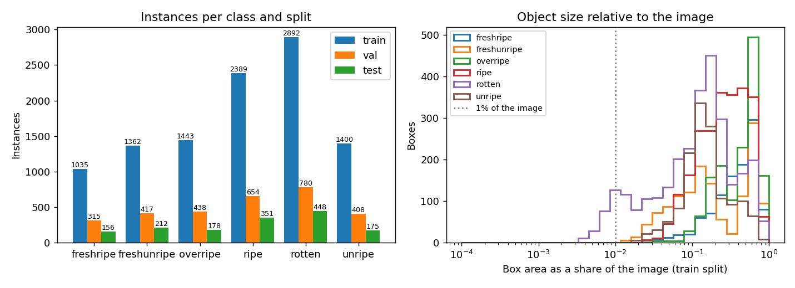
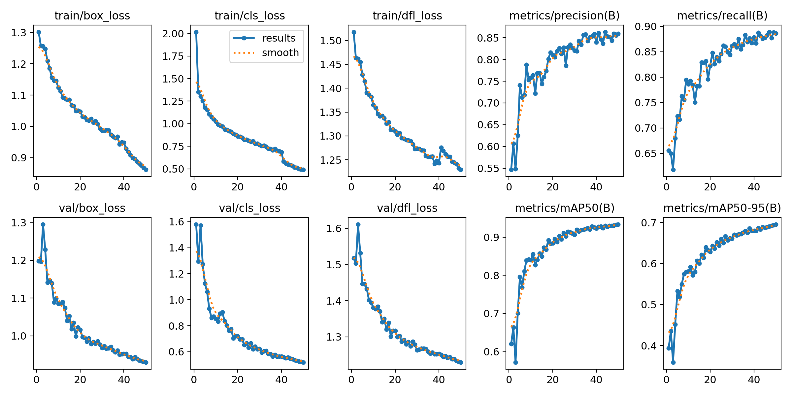
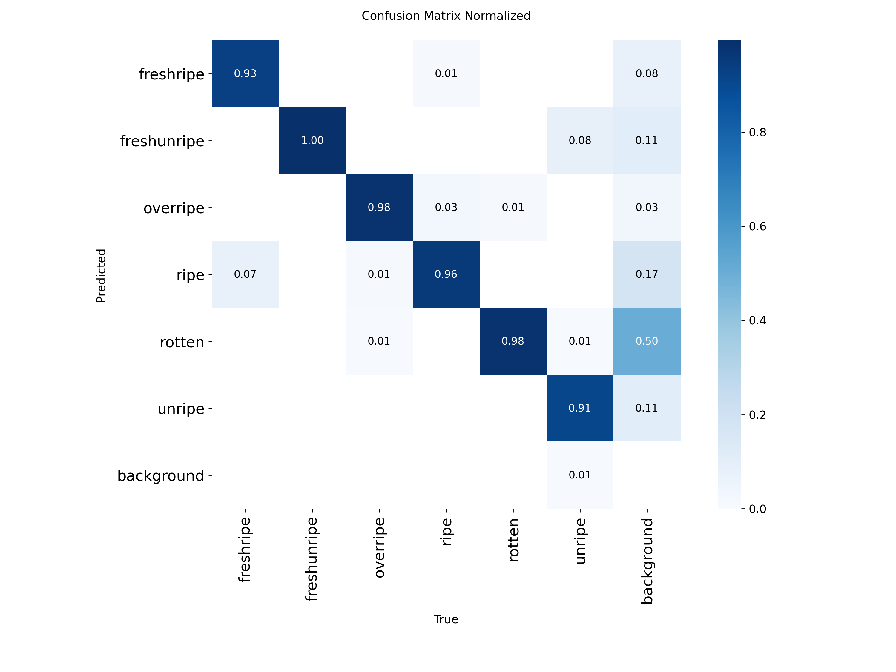
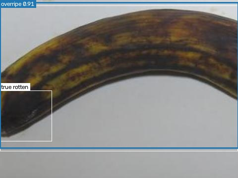
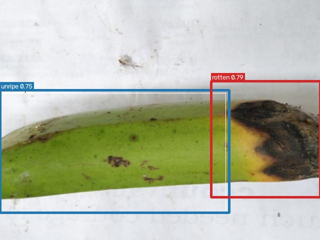
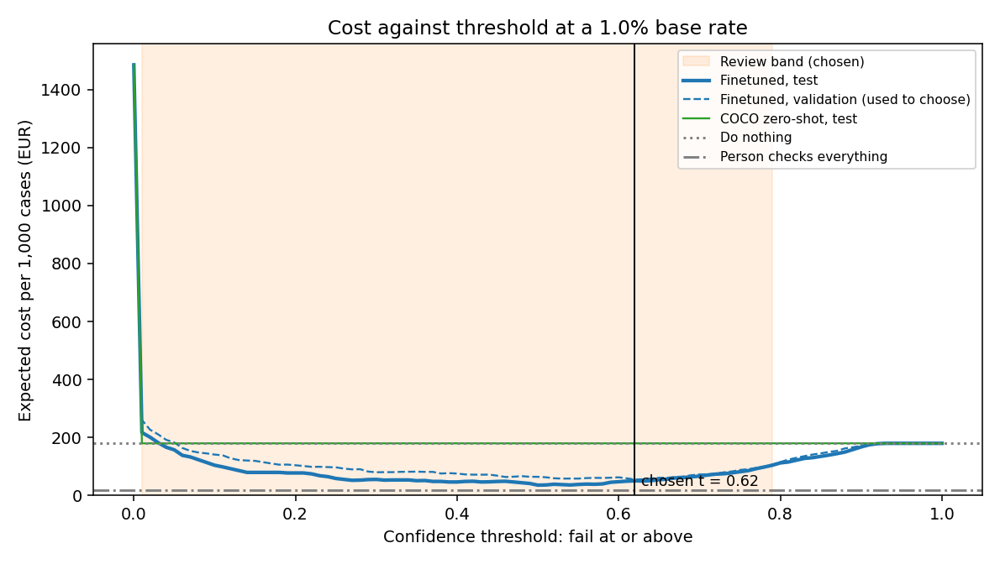

# Banana Rot Detection: Model Evaluation and Cost Analysis

- **Name**: Enrique Roca de Togores
- **Student ID**: 20044
- **Email**: erocadetogor.ieu2022@student.ie.edu
- **Group**: BBADBA 5B

## Business problem, and the cost of being wrong

The business problem considered in this project is the detection of rotten bananas at a banana packing facility in the Canary Islands. A camera takes pictures of the bananas on a conveyor belt, and an object detection model analyses each image to support the quality control process. Based on the model's predictions, each banana hand can either pass inspection and be packaged, be sent for human review, or fail inspection and be removed from the production line. If a rejected hand can be reprocessed, it may be recovered; otherwise, it must be discarded.

The positive class is `rotten`, since the main objective is to identify bananas affected by rot. The costs of incorrect decisions are asymmetric. A false positive occurs when a good banana is classified as rotten. Assuming that a banana hand weighs 2 kg and that the production cost is €0.75 per kilogram, the cost of this mistake is €1.50 per hand. A false negative occurs when a rotten banana hand is classified as good and passes inspection. In this scenario, the estimated cost is €18, corresponding to two boxes containing 12 kg each, valued at the same production cost of €0.75 per kilogram. True positives and true negatives are assigned a cost of €0 because the model makes the correct decision.

| Outcome | Cost per hand | Derivation |
|---|---|---|
| False positive (good hand removed) | €1.50 | 2 kg × €0.75/kg |
| False negative (rotten hand packed) | €18.00 | 2 boxes × 12 kg × €0.75/kg |
| True positive (rotten hand removed) | €0 | — |
| True negative (good hand packed) | €0 | — |

Therefore, a false negative is twelve times more expensive than a false positive. This difference is important because a rotten banana that passes inspection could affect other fruit in the same box during transport to mainland Spain, potentially causing further deterioration, quality problems and losses. The assumption of two boxes represents the estimated amount of product potentially affected by one missed rotten hand, although this figure should be validated with operational data.

Production cost is used instead of the selling price because the analysis aims to estimate the direct economic loss associated with the fruit rather than its potential retail value. The actual consequences could be higher if transport, handling, customer claims or reputational damage were included, but these are not incorporated into the current cost matrix.

The model is intended to support the quality control operator rather than replace human judgement completely. This is particularly important because the consequences of incorrectly accepting rotten fruit can be more serious than those of unnecessarily rejecting good fruit.

## Dataset

The project uses version 1 of the `fruit-ripening-process` dataset, published by the `fruit-ripening` workspace on Roboflow Universe. The selected version is the raw dataset without additional augmentations.

- **Workspace / project / version:** `fruit-ripening` / `fruit-ripening-process` / `1`
- **Link:** https://universe.roboflow.com/fruit-ripening/fruit-ripening-process/dataset/1

The dataset contains six classes: freshripe, freshunripe, overripe, ripe, rotten and unripe. The images mainly show individual bananas photographed at close range against relatively simple backgrounds. This makes the dataset useful as a starting point because it contains examples of different ripening conditions and explicitly includes the rotten class, which is the target of the business problem.

However, the dataset does not fully represent the intended production environment. At the packing facility, bananas are handled at origin and are generally packaged while still green. The camera would photograph banana hands on a conveyor belt, rather than individual bananas under relatively controlled photographic conditions. Consequently, the dataset is relevant for learning visual differences associated with rot, but its suitability for the actual production line cannot be assumed without further testing.

The distinction between ripeness and rot is particularly important. A ripe or overripe banana is not necessarily rotten, and a model trained on these images must learn to distinguish normal ripening from actual deterioration. This distinction will need to be validated using images collected in the intended production environment.

## What the dataset's composition implies

The dataset contains 5,264 training images, 1,525 validation images and 757 test images. Each image contains approximately two annotated objects on average, and there are no empty images. This means that the model is trained and evaluated on images containing annotated fruit rather than on a mixture of fruit images and empty conveyor-belt scenes.

| Split | Images | Images with rotten fruit | Share |
|---|---|---|---|
| Train | 5,264 | 1,841 | 35.0% |
| Validation | 1,525 | 527 | 34.6% |
| Test | 757 | 288 | 38.0% |

The proportion of images containing at least one rotten banana is approximately 35% in the training set, 34.6% in the validation set and 38% in the test set. In the test set, 288 of the 757 images contain rotten fruit. These proportions are much higher than the assumed 1% prevalence of rotten banana hands in production. This difference matters because the test set does not reproduce the expected real-world distribution of good and rotten fruit.

| Class | Train | Validation | Test | Median box area (train) |
|---|---|---|---|---|
| rotten | 2,892 | 780 | 448 | 13.5% |
| ripe | 2,389 | 654 | 351 | 26.7% |
| overripe | 1,443 | 438 | 178 | 51.1% |
| unripe | 1,400 | 408 | 175 | 14.1% |
| freshunripe | 1,362 | 417 | 212 | 15.7% |
| freshripe | 1,035 | 315 | 156 | 43.0% |

Although some classes have fewer examples than others, all six classes have enough annotated instances to support an initial evaluation. Nevertheless, the smaller test counts for some classes mean that their estimated performance may be less stable. The number of instances alone does not establish whether a class is adequately represented, since image diversity, annotation quality and the variety of fruit conditions also matter.

Object size introduces another limitation. A typical bounding box for a rotten banana occupies a median of approximately 14% of the image, while an overripe object occupies approximately 50%. Bounding boxes covering less than 1% of an image are rare. The model is therefore not being tested extensively on very small defects. In a real packing line, rot might appear only as a small damaged area on the tip of an otherwise healthy banana. Detecting these local defects could be more difficult than detecting the larger affected regions represented in the dataset.

For these reasons, the test results should be interpreted as evidence of performance on this dataset, not as proof of equivalent performance on the production line. The differences in fruit appearance, camera conditions, object size and class prevalence limit the conclusions that can be drawn about real-world performance.

## Finetuning and baselines

The selected model is `yolo11n`, a lightweight YOLO object detection model. Object detection is appropriate because the system needs to identify the location of potentially rotten areas rather than simply classify an entire image. The nano version was selected because inference speed is important in a conveyor-belt environment, where the model must analyse images without slowing down production.

Training was performed in Google Colab using a Tesla T4 GPU. The model was trained for 50 epochs with an image size of 640 pixels, a batch size of 16, a patience value of 15 and random seed 0. Training took approximately 64.6 minutes using Ultralytics version 8.4.190.

| Model (same test split) | mAP50 | mAP50-95 | Image-level AUC | Cost per 1,000 hands* |
|---|---|---|---|---|
| Finetuned yolo11n | **0.938** | **0.708** | **0.993** | €50.71 |
| COCO yolo11n, zero-shot | 0.000 | 0.000 | 0.500 | €180.00 |
| Trivial baseline (predicts nothing) | 0.000 | 0.000 | 0.500 | €180.00 |

\*Model deciding alone at the threshold chosen on validation, at a 1% base rate.

The finetuned model achieved a test mAP50 of 0.938 and a mAP50-95 of 0.708. Its image-level AUC was 0.993. These results indicate strong performance on the test dataset, although the difference between the two mean average precision metrics suggests that precise bounding-box localisation is more challenging under stricter evaluation criteria. As a cross-check, the official Ultralytics validator on the same test split reports a precision of 0.881, a recall of 0.913, a mAP50 of 0.948 and a mAP50-95 of 0.704.

Two baselines were also considered: a zero-shot model based on COCO and a model that makes no predictions. Both achieved a mAP50 of 0, a mAP50-95 of 0 and an image-level AUC of 0.5.

The COCO model can recognise the general category of a banana, but it does not provide the specialised ripeness and rot categories required by this task. Therefore, its zero-shot predictions do not match the target labels, resulting in zero detection metrics under the evaluation setup used. Similarly, the model that makes no predictions cannot detect any annotated objects and performs no better than random ranking for image-level AUC.

The large difference between the finetuned model and the baselines was expected to some extent because the finetuned model learns the specific categories from the target dataset, whereas the baselines do not. However, the results do not establish how well the model will generalise to the production line, since all these comparisons use the same test dataset.

## Per-class evaluation and failure modes

The per-class AP50 results show that the model performs relatively well across all six categories. overripe achieves the highest AP50 at 0.974, followed by freshunripe at 0.953, freshripe at 0.944, ripe at 0.926, rotten at 0.925 and unripe at 0.904.

| Class | Test instances | AP50 | AP50-95 | Precision* | Recall* |
|---|---|---|---|---|---|
| overripe | 178 | 0.974 | 0.823 | 0.912 | 0.994 |
| freshunripe | 212 | 0.953 | 0.763 | 0.863 | 0.929 |
| freshripe | 156 | 0.944 | 0.785 | 0.907 | 0.910 |
| ripe | 351 | 0.926 | 0.678 | 0.853 | 0.897 |
| **rotten (positive)** | 448 | 0.925 | **0.577** | 0.903 | 0.875 |
| unripe | 175 | 0.904 | 0.623 | 0.849 | 0.874 |

\*Ultralytics validator, at the confidence that maximises F1.

These results suggest that the model can distinguish the different ripening categories reasonably well under the conditions represented in the dataset. However, rotten has the lowest AP50-95, at 0.577. This indicates that, although the model often detects rotten fruit, its bounding boxes are less accurate when evaluated using stricter overlap requirements. The model may identify the affected banana but fail to outline the relevant region precisely.

Ultralytics' additional evaluation reports a precision of 0.903 and a recall of 0.875 for rotten, at the confidence that maximises F1. Precision indicates that most predictions labelled as rotten are correct, while recall indicates that the model detects 87.5% of the annotated rotten instances under the evaluation settings used. The remaining missed detections are important because false negatives have a high estimated economic cost in the proposed business scenario.

Inspection of the saved failure examples (also shown in the dashboard's "Where it fails" tab) reveals a recurring confusion between overripe and rotten. In some cases, the model labels an entire banana as overripe, with confidence scores between 0.74 and 0.93, while failing to detect a rotten tip. In other cases, it produces false alarms with confidence scores of 0.79 and 0.62 for banana tips that resemble rotten areas. Some of these cases may also reflect ambiguous or inconsistent ground-truth annotations.

The distinction between overripe and rotten is therefore one of the main challenges of the task. An overripe banana may have extensive colour changes and dark spots without necessarily being rotten, whereas rot may affect only a small part of an otherwise acceptable banana. The model must learn the visual characteristics that separate these conditions, rather than treating all dark or deteriorated-looking areas as equivalent.

The high AP50 of overripe contributes positively to the overall detection results, while the lower localisation performance of rotten is a significant weakness for the business objective. Since detecting rotten fruit is more important than distinguishing the other ripeness categories, future improvements should prioritise rotten-fruit recall, small-defect detection and the consistency of the annotations.

## Cost matrix and operating point

| Assumption | Value | Source |
|---|---|---|
| Production cost | €0.75/kg | Midpoint of the €0.70–0.80/kg production cost reported for Canary bananas [1] |
| Weight of a hand | 2 kg | Bunches of ≥20 kg [2] with about 10 hands each [3] |
| Box | 12 kg | Canary banana export standard [2] |
| False negative | €18 | 2 boxes × 12 kg × €0.75/kg (assumption) |
| Base rate | 1% | Assumption; about 2.5% of Canary production is withdrawn and destroyed, but for market reasons rather than rot [4] |
| Volume | 25,000 hands a day | 50,000 kg/day ÷ 2 kg; the sector produced 374.6 million kg in 2025 [5] |
| Reviewer cost | €12.40/hour | 2026 minimum wage, €17,094/year [6], over 1,808 hours/year [7], plus employer social security |
| Review time | 5 seconds | Provisional estimate, to be measured |

The economic evaluation assumes that 1% of banana hands in production are rotten. This is a provisional base-rate assumption rather than a measured figure. It is used to estimate the expected costs under a realistic scenario in which good fruit is much more common than rotten fruit. The true prevalence could differ depending on the supplier, season, storage conditions and quality control procedures, so it should be measured before deployment.

The operating threshold is selected using the validation set and then evaluated on the test set. This separation helps prevent the test results from influencing the threshold selection and provides a more independent assessment of the chosen operating point.

For the model-only strategy, the selected rejection threshold is 0.62. Under the assumed production prevalence and cost matrix, this strategy produces an estimated cost of €50.71 per 1,000 banana hands. It misses 24.7% of rotten hands and rejects approximately 0.4% of good hands.

At first, a relatively high rejection threshold may seem surprising because a false negative costs twelve times more than a false positive. However, the number of good hands is assumed to be much larger than the number of rotten hands. Out of every 1,000 hands, approximately 990 are good and only 10 are rotten. Consequently, false alarms can accumulate across a large number of good products, while the assumed number of rotten products remains small.

Under this scenario, each percentage point of false-positive rate corresponds to approximately 9.9 good hands and costs about €14.85. Each percentage point of false-negative rate corresponds to approximately 0.1 rotten hands and costs about €1.80. This helps explain why the optimal threshold is not determined solely by the relative cost of the two types of error. It also depends on their respective frequencies and on the model's confidence scores.

The sensitivity analysis in `sensitivity.csv` evaluates how the results change under alternative assumptions. The upper threshold remains at 0.79 across the scenarios considered, while the lower threshold varies from 0.01 to 0.29. The proportion of hands sent for human review ranges from 3% to 16%. In all the tested scenarios, the estimated cost remains substantially below that of taking no action.

| Scenario | Model-alone threshold | Review band | Sent to review | Cost per 1,000 | Do nothing per 1,000 |
|---|---|---|---|---|---|
| Base rate 0.25% | 0.66 | 0.14 – 0.79 | 5.2% | €1.84 | €45 |
| **Base rate 1% (chosen)** | **0.62** | **0.01 – 0.79** | **14.9%** | **€4.45** | **€180** |
| Base rate 4% | 0.30 | 0.01 – 0.79 | 16.2% | €10.29 | €720 |
| False negative €4.50 | 0.66 | 0.14 – 0.79 | 5.6% | €1.91 | €45 |
| False negative €72 | 0.30 | 0.01 – 0.79 | 14.9% | €10.07 | €720 |

Nevertheless, the results depend strongly on the assumptions used in the cost model. If the actual prevalence of rot is much higher than 1%, missing rotten fruit becomes more costly than estimated. If one rotten hand can affect more than two boxes, the false-negative cost also increases. Conversely, if the actual consequences are smaller, the preferred thresholds may change. The assumed base rate and the cost of a false negative are therefore two of the most important quantities to validate before deployment.

**Sources**

1. Moncloa.com (1 August 2026), *El precio del plátano canario se hunde*: https://www.moncloa.com/2026/08/01/precio-platano-canarias-0-36-euros-3409068/
2. BOE, 3 August 1966, export standards for Canary bananas: https://www.boe.es/boe/dias/1966/08/03/pdfs/A10046-10048.pdf
3. Zamorano agronomic study, bunch weight and number of hands (a different cultivar, used as an approximation): https://bdigital.zamorano.edu/bitstreams/4ad3006f-79e1-4457-95b3-7ce1f28bd36d/download
4. Fruitnet, *Canarian bananas withdrawn from market*: https://www.fruitnet.com/eurofruit/canarian-bananas-withdrawn-from-market/174199.article
5. Agronews Castilla y León, Canary banana production and prices 2026: https://www.agronewscastillayleon.com/platano-canarias-planificacion-produccion-precios-2026
6. Real Decreto 126/2026, minimum wage for 2026: https://www.boe.es/eli/es/rd/2026/02/18/126/con
7. BORM 2026, collective agreement for fruit and vegetable handling (annual working hours): https://www.borm.es/services/anuncio/ano/2026/numero/75/pdf?id=840739

## What a person still has to check

A human-in-the-loop strategy introduces a review band between the two automated decisions. Under the proposed configuration, hands with scores below 0.01 pass automatically, while hands with scores of 0.79 or higher fail automatically. Predictions falling between these thresholds are sent to an operator for inspection.

This approach is intended to reduce the cost of incorrect automated decisions by allowing a person to examine uncertain cases. According to the estimates, 14.9% of banana hands would require review, corresponding to approximately 3,731 reviews per day. If each review takes five seconds, the workload would be approximately 5.2 hours of human work per day, equivalent to around 0.74 full-time workers based on the available staffing assumptions.

The five-second review time is provisional and must be measured in practice. The labour-cost estimate uses an hourly rate of approximately €12.40, derived from the 2026 statutory minimum wage of €17,094 per year (Real Decreto 126/2026) divided by 1,808 annual working hours, with an additional allowance for employer social security costs. At this rate, a five-second review costs approximately €0.017 per hand.

The test-set results illustrate how the three-way decision system behaves. Of the 288 test images containing rotten fruit, 3 are passed, 164 are sent for review and 121 are rejected. Of the 469 test images without rotten fruit, 401 are passed, 68 are sent for review and none are rejected.

| Truth (test images) | Pass | Review | Fail |
|---|---|---|---|
| Rotten (288) | 3 | 164 | 121 |
| Good (469) | 401 | 68 | 0 |

These figures suggest that human review can recover many cases that the model cannot classify confidently enough for an automatic decision. However, the test set contains a much higher proportion of rotten examples than the assumed production environment, and the reported counts should be interpreted within the exact evaluation setup. They should not be treated as direct estimates of daily production performance without adjusting for the real base rate.

The comparison between the four strategies gives the following estimated results:

| Strategy | Cost per 1,000 hands | Daily cost | Staffing requirement |
|---|---|---|---|
| No action | €180 | €4,500 | 0 |
| Human inspection of every hand | €17 | €431 | Approximately 5 people (only 2 available) |
| Model only | €51 | €1,268 | 0 |
| **Model plus human review** | **€4.45** | **€111** | **Approximately 0.74 people** |

These estimates indicate that combining automated detection with human review could provide a substantial economic advantage over the alternatives. Doing nothing is expensive because rotten fruit is allowed to pass, while inspecting every hand manually would require more staff than the two available workers. The model-only strategy reduces the workload but still misses a proportion of rotten fruit. The combined strategy aims to balance automated decisions with targeted human inspection.

The workload estimate also depends on the assumption that each review takes only five seconds. If the average review time increases to ten seconds, the review workload doubles to approximately 10.4 hours per day, equivalent to about 1.48 full-time workers under the same assumptions. The system could still fit within the two available workers in purely numerical terms, but less capacity would remain for other duties, breaks and unexpected production demands.

Operator fatigue is another practical concern. Repetitive inspection can reduce attention and consistency, especially during long shifts. The assumption that the operator never makes a mistake is therefore optimistic. A realistic pilot should measure review times, monitor agreement between operators and assess performance over a full shift. If human errors or fatigue are significant, the estimated economic benefit of the combined strategy will need to be revised.

## Limitations & next steps

The first limitation is the mismatch between the dataset and the intended production environment. The dataset mainly contains individual bananas photographed against simple backgrounds, whereas the production camera will observe green banana hands on a conveyor belt. To address this issue, the next step would be to collect and annotate images directly from the packing line, including normal green fruit, damaged tips, partially hidden bananas and different lighting conditions. The model should then be finetuned and evaluated on a representative sample of those images.

The second limitation concerns potentially ambiguous labels, especially between overripe and rotten. Some errors may be caused by the model, while others may result from inconsistent annotations. A review of difficult examples by experienced quality control staff would help establish clearer labelling rules. These rules should distinguish normal ripening, overripe fruit and actual rot, with particular attention to small affected areas.

The third limitation is the uncertainty surrounding the 1% base rate and the €18 false-negative cost. Both values are assumptions rather than verified operational measurements. The packing facility should collect data on the actual proportion of rotten hands, investigate how frequently a missed defect affects other boxes and estimate the resulting financial losses. The cost matrix and operating thresholds could then be updated using observed values rather than provisional assumptions.

The fourth limitation is the assumed five-second review time. This figure should be measured through timed trials with the intended camera interface and actual production staff. The pilot should record average review time, variation across operators and the proportion of cases that require closer inspection. If reviews take longer than expected, the staffing plan and total operating cost must be recalculated.

Finally, the analysis assumes that human reviewers always make the correct decision. In practice, operators can overlook defects or disagree about borderline cases. The system should therefore include clear inspection guidelines, appropriate training and periodic quality checks. A sample of reviewed cases could be inspected independently to estimate human error rates and determine whether additional training or changes to the review interface are necessary.

Before deployment, the complete system should be tested in a controlled production pilot. This pilot should evaluate not only detection metrics but also false-negative rates, review workload, throughput, operating costs and the stability of performance across different batches and working conditions.

## Generative AI use disclosure

Claude, developed by Anthropic, was used to assist with the development of `train.py`, `app.py`, `evaluation.py`, `costing.py` and `config.py`. It was also used to help identify the dataset and find reference information, as well as to provide guidance during the development and evaluation process.

The project decisions, including the business scenario, the cost assumptions, the assumed base rate and the staffing estimates, were made by the student. The report's analysis and final explanations were also prepared by the student and should reflect their own understanding of the methods, results and limitations.
